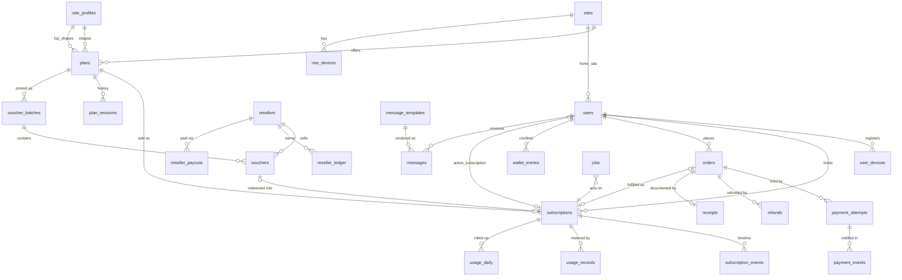

# 2. Database Schema

Two PostgreSQL databases with a deliberately hard boundary between them.

| | **Cloud** (Supabase) | **Edge** (on-site box) |
|---|---|---|
| Migration | `db/migrations/0001_initial_cloud.sql` | `db/migrations/0002_edge_radius.sql` |
| Tables | 42 | 15 |
| Role | **Authoritative** — money, entitlements, identity | **Projection** — only what a RADIUS decision needs |
| Writes from | The Express app | `syncd` (from the cloud) and FreeRADIUS (accounting) |
| Never holds | RADIUS shared secrets, live auth decisions | Prices, payments, receipts, the authoritative subscription |
| Backup | Supabase PITR + daily logical dump off-site | Nightly `pg_dump` shipped off-site; restore-tested weekly |

**The rule that keeps this maintainable:** the edge database is *derived*. Nothing on the
edge is ever edited by a human, and if it is corrupted or lost it is rebuilt from the cloud
in one full-reconcile pass. The cloud database is the only place a fact is *decided*.

Generated full column inventory (never drifts from the SQL): **[schema-reference.md](./schema-reference.md)**,
regenerate with `npm run db:docs`.

---

## 2.1 Conventions

| Thing | Rule | Why |
|---|---|---|
| **Money** | `bigint` pesewas, suffix `_pesewas` | Paystack charges in pesewas, so no rounding ever crosses the payment boundary. A `numeric(10,2)` cedi column would need a conversion at exactly the place you can least afford a bug. |
| **Time** | `timestamptz`, rendered `Africa/Accra` | Ghana is GMT+0 with no DST, which is a gift — but store zone-aware anyway so a future second site in another zone is not a migration. |
| **Phone** | `*_e164` (`+233244123456`, the unique key) + `*_local` (`0244123456`) | Arkesel wants `+233…`; Paystack MoMo wants the 10-digit local form; humans type either. Normalise once (`app_normalize_gh_phone`) and keep both. |
| **MAC** | `text`, `AA:BB:CC:DD:EE:FF` upper-case, CHECK-constrained | MikroTik sends lower case, iOS/Android randomise per-SSID by default. Normalise on **both** sides (`app_normalize_mac`) or binding silently never matches. |
| **IDs** | `uuid` (`gen_random_uuid()`); `bigserial` only for high-volume append-only logs | UUIDs let the edge node mint ids offline without collision. Serials are used where an index-ordered insert matters (`usage_records`, `audit_log`). |
| **Statuses** | `text` + `CHECK`, not native `enum` | `ALTER TYPE … ADD VALUE` cannot run inside a transaction, which breaks most migration runners. A CHECK is amendable in one statement. |
| **Soft delete** | `deleted_at` only on `users`, `plans`, `resellers` | Everywhere else a hard delete is correct. On these three, deleting would destroy the audit trail of money movement or erase an entitlement a customer paid for. |
| **Optimistic locking** | `version int` on `orders`, `subscriptions`, `vouchers`, `nas_devices` | A webhook and a browser poll can both try to fulfil the same order. `WHERE version = :v` makes one of them lose cleanly. |
| **Timestamps** | `created_at` / `updated_at` on everything mutable, trigger-maintained | `app_touch_updated_at()`. No application code sets `updated_at`; that is how you get a column you can trust. |

---

## 2.2 Entity relationships (core)



Three relationships are worth calling out because they are **circular or unusual by design**:

- `orders.subscription_id` ↔ `subscriptions.order_id`. Created with the FK added by
  `ALTER TABLE` after both tables exist. An order *produces* a subscription; a subscription
  records *which order* paid for it. Both directions are needed — one for fulfilment
  idempotency, one for support ("show me the payment behind this month of service").
- `users.active_subscription_id` → `subscriptions.id`, also added by `ALTER TABLE`. A
  denormalised pointer that turns the most-read query on the portal ("what is my plan?") into
  a single indexed lookup instead of a filtered scan of the subscription ledger. It is
  maintained in the same transaction as the subscription status change, and a nightly job
  asserts it agrees with `subscriptions` — a denormalisation without a reconciliation check
  is just a bug with extra steps.
- `vouchers.subscription_id` ↔ `subscriptions.voucher_id`. Same pattern, same reason.

---

## 2.3 Domain walkthrough

### Identity — minimal by law, not by accident

`users` holds **phone number** (required — it is simultaneously the account key, the login
username and the payment instrument), an **optional** first name, an **optional** email, and
usage totals. No address, no Ghana Card number, no date of birth, no photo. That is the
Ghana Data Protection Act 2012 (Act 843) minimisation principle applied literally: collect
what the service needs and nothing that only makes a breach worse.

`users.username` defaults to `phone_local` — so the customer's Wi-Fi login is the number they
already know, and there is nothing to forget. It is overridable, because some customers will
want a shorter code for a shared household device.

`users.password_hash` is **nullable on purpose**. A customer who only ever buys vouchers needs
no password, and forcing one on a shared family phone in a low-literacy market creates support
load and churn for zero security benefit. OTP is the primary credential.

Compliance is modelled, not just documented:

- `privacy_notices` is versioned; `users.privacy_notice_id` records *which version* this
  customer accepted, so you can prove what they saw.
- `users.marketing_consent` is a **separate, revocable** flag from service consent. Marketing
  SMS is additionally gated by `settings.sms.marketing_window` (08:00–19:00, not Sundays).
- `users.deleted_at` is the erasure path; the purge job removes identity and raw usage while
  retaining the aggregated financial rows the law requires.
- `settings.legal.data_protection_registration` records your Data Protection Commission
  registration number. **Registering as a data controller is an obligation under Act 843, not
  a nice-to-have.**

`user_devices` carries two *separate* controls that are easy to conflate:

| Control | Column | Enforced by |
|---|---|---|
| How many devices may be **online at once** | `plans.max_simultaneous_devices` | FreeRADIUS `Simultaneous-Use`, checked against open `radacct` rows |
| How many devices may be **registered** to the account | `plans.max_registered_devices`, rows in `user_devices` | The edge `edge_devices` policy at Access-Request time |
| Only registered MACs may connect **at all** | `is_bound` (per device) / `mac_binding_required` (per plan) / `mac_binding_enabled` (per user) | Same policy, hard reject |

The third is what actually stops account sharing. The first two are what make a GH¢100
"family" plan sellable without it becoming a compound-wide free-for-all. A new MAC arrives as
`status='pending'` and is pushed to the cloud so the customer can approve it from the portal —
because the alternative is a support call for every new phone in the household.

### Catalogue — everything an admin needs to change is a row

`plans` is the sellable catalogue and every commercially interesting knob is a column: price,
renewal price, tax, duration, data cap, speed profile, fair-usage threshold and action, device
limits, MAC binding, session/idle timeout, grace period, stacking behaviour, visibility, sort
order and validity window. **Nothing here requires a deploy to change.**

`rate_profiles` is normalised out of `plans` for two reasons: several plans can share a
profile, and a speed change becomes one `UPDATE` instead of N. The columns mirror the
`Mikrotik-Rate-Limit` attribute exactly:

```
rx-rate[/tx-rate] [rx-burst-rate[/tx-burst-rate] [rx-burst-threshold[/tx-burst-threshold]
                 [rx-burst-time[/tx-burst-time] [priority] [rx-rate-min[/tx-rate-min]]]]
```

> **`rx` is the client's UPLOAD and `tx` is the client's DOWNLOAD** — the attribute is written
> from the *router's* point of view. A plan sold as "12 down / 6 up" must be rendered
> `"6M/12M …"`. This is the single most common MikroTik billing bug, it produces no error
> anywhere, and it presents to the customer as "the internet is slow".
>
> **`burst-threshold` is an average RATE in bits/s, not a byte allowance.** Renaming the column
> `_bytes` would be a plausible-looking way to ship a burst config that never fires. It is
> `_kbps` here for that reason.

`plan_revisions` stores a full JSON snapshot plus a field-level diff on **every** plan update.
This is the answer to "I paid GH¢70 last month, why is it GH¢90 now?" and to "did the speed
drop or did the customer imagine it?" — both routine disputes in a reseller business, and both
unanswerable without history.

`network_rules` is the block/allow list, and the important column is `enforcement`: it records
*how* a rule lands on the network (`dns`, `address_list`, `layer7`, `raw_mangle`,
`walled_garden`). Rules are **rendered to a RouterOS script** rather than pushed live, so a bad
rule cannot take the network down at 9 pm — you review the diff and apply it.

### Entitlements — a ledger, not a mutable "current plan"

`subscriptions` is one row **per purchased period**. This is the most important structural
decision in the schema.

The alternative — one mutable row per customer that you `UPDATE expires_at = expires_at + 30
days` on renewal — looks simpler and destroys information: you lose the price actually paid,
the terms actually sold, and any ability to answer "what did this customer buy in March?".

Consequences of the ledger design:

- **Stacking works honestly.** Buying a second month while the first is running inserts a row
  with `status='scheduled'` and `starts_at = current.expires_at`. "Renew early and keep your
  remaining days" falls out of the data model rather than being special-cased.
- **Double-activation is impossible at the database layer.**
  `CREATE UNIQUE INDEX subscriptions_one_active_per_user ON subscriptions (user_id) WHERE
  status = 'active'` — a partial unique index. A webhook delivered twice, or two workers
  racing, cannot give one customer two concurrent plans. Application logic can have a bug;
  this cannot.
- **Terms are snapshotted.** `snapshot_price_pesewas`, `snapshot_data_cap_bytes`,
  `snapshot_rate_profile_id`, `snapshot_max_*` are copied from the plan at purchase time and
  `plan_revision` pins which version. An admin repricing or re-speeding a plan next month must
  never retroactively change what a customer already paid for. Without snapshots, "we improved
  everyone's plan" can silently mean "we cut someone's data cap".
- `subscription_events` is the human-readable timeline — activated, renewed, extended,
  throttled, disconnected, expired, device blocked, `coa_sent`, `coa_failed`. It is the single
  most useful table in a support conversation, and `coa_failed` in particular is how you notice
  that live disconnects silently stopped working after a router reboot.

### Money — never trust anything from outside

`orders` is the intent to buy. `payment_attempts` is each try at collecting the money (a
customer can fail on Telecel, retry on MTN, then pay by card — three attempts, one order).
`payment_events` is the webhook inbox. `refunds`, `receipts`, `settlements` and
`settlement_items` close the loop.

The non-obvious constraints:

- **`orders_total_ck`**: `total_pesewas = (unit_price × quantity) − discount + tax`. The client
  sends a plan code, a quantity and an idempotency key — **never an amount**. A tampered total
  is a constraint violation, not a business-logic branch. This is the cheapest possible defence
  against paying GH¢1 for a GH¢100 plan.
- **`orders.idempotency_key` is UNIQUE.** A double-tapped "Pay GH¢70" button on a laggy
  connection cannot create two charges. This matters more than usual here: satellite latency
  makes double-submit *likely*, not theoretical.
- **`payment_attempts.reference` is UNIQUE and is ours** (`WV-<orderRef>-<n>`), not Paystack's.
  It is the join key for webhooks and verify calls, and uniqueness means a replayed webhook
  cannot attach to the wrong attempt.

`payment_events` is the idempotency gate, and its shape is driven by a Paystack quirk:

> **Paystack sends no unique event ID and retries the webhook on any non-2xx response.**
> So there is nothing from the provider to dedupe on. `dedupe_key` is instead
> `sha256(provider | event | data.id | data.status | data.reference)` with a UNIQUE index, and
> `body_hash` records the hash of the exact raw body as a second line of defence.
>
> The handler **inserts into `payment_events` first, in its own transaction**, before any
> business logic runs. A redelivery hits a unique violation and returns 200 immediately
> without re-activating anything. Every other design here is a race waiting to happen.

Two more Paystack traps recorded in the schema:

- The response envelope's `status: true` does **not** mean the charge succeeded. A too-short
  phone number and a declined payment both return `status: true`. Only `data.status` counts.
- `payment_attempts.display_text` stores the operator's own instruction verbatim ("Please dial
  \*110# to generate a voucher code…"). Inventing friendlier copy here is how customers get
  stuck mid-payment. `momo_provider_code` records what was actually sent, because Paystack's
  own docs have listed AirtelTigo as both `atl` and `tgo` over time — the mapping lives in
  `settings`, correctable without a deploy.

`wallet_entries` is an append-only credit ledger behind `users.wallet_pesewas`, with
`balance_after_pesewas` written in the same transaction as every change. It exists because in
Ghana the practical remedy for a failed activation or a duplicate GH¢5 charge is usually wallet
credit, not a Paystack reversal — operator refunds can take days, and a customer who waits
three days for GH¢5 does not come back. `balance_after_pesewas` makes gaps and double-applies
visible in a single query.

`refunds` requires approval by a **different** admin than the requester
(`billing.refund_requires_second_admin`), so one compromised account cannot drain the till.

### Vouchers — the resilience path

`voucher_batches` is a print run; `vouchers` are the codes. Batching is what makes voucher
economics work: generate 200 codes once, export one CSV/PDF, hand the book to a shopkeeper,
reconcile sold-vs-unsold **per book** rather than per code. `face_value_pesewas` (retail) vs
`unit_cost_pesewas` (wholesale) is the reseller margin. Voiding a batch instantly kills every
unused code in it — the response to a lost or stolen book.

Codes are Crockford Base32 (no `I`, `L`, `O`, `U`) with a mod-31 check digit
(`app_voucher_code_valid` / `app_voucher_check_digit`). Two reasons: they can be read aloud in
a noisy shop and typed without ambiguity, and ~99 % of typos are rejected *locally* before
touching the database — which matters because voucher guessing is the number-one attack on this
kind of system, and every miss that reaches Postgres is a chance to rate-limit the wrong thing.

Redemption is a conditional `UPDATE … WHERE status='unused' AND version=:v`. Two people
submitting the same code on two phones simultaneously cannot both succeed, and that guarantee
comes from the database rather than from an application lock that a second server instance
would not share.

> Vouchers are also **business continuity**. When Paystack or Arkesel is down you can still
> sell access for cash with a code printed that morning. Do not remove them to simplify.

### Usage — accounting that survives a bad link

`usage_records` (cloud) is the ingest target for edge `radacct` rows. `origin_id` is **UNIQUE**,
which is what makes the uplink idempotent: the edge keeps a `sync_outbox` and retries until the
cloud acks, so a Starlink dropout mid-POST can never double-count a customer's data.

`user_id` and `subscription_id` are resolved from `username` at ingest time, so the dashboard
never joins on a text username — that join is the difference between a 5 ms and a 500 ms
dashboard query once there is a year of data.

`usage_daily` is the per-customer per-day rollup that powers "usage history" on the account
page and "bandwidth used" / "top users" on the dashboard. `subscription_id` is `NOT NULL` here
on purpose: usage that cannot be attributed to an entitlement stays in `usage_records` and is
surfaced as an anomaly rather than silently absorbed into someone's total.

`revenue_daily` is the same idea for money, with `by_network` and `by_plan` JSON breakdowns.
`by_network` is the operationally important one: if MTN revenue collapses to zero on a Tuesday,
the MoMo channel is down — not your business — and you need to know before customers start
calling.

### Messaging — one row per SMS, and a dedupe key per *intent*

`messages.dedupe_key` is the mechanism that stops a customer receiving four "your plan expires
in 2 days" texts when the reminder job retries. The job computes a deterministic key
(`reminder:expiry_d2:<subscription_id>`) and the UNIQUE index does the rest.

The Arkesel delivery report has an unusual security property worth stating plainly: **it
arrives in batches, late, at an unauthenticated callback URL.** So the handler must resolve
`sms_id` against `messages.provider_message_id` and ignore anything it does not recognise. It
must never trust a status for a message it did not send.

> **`GH¢` is not in the GSM-7 character set** and forces the message into UCS-2, halving the
> per-segment length from 160 to 70 characters. Every customer template uses `GHS`. At roughly
> 20,000 messages/month across 100 subscribers (OTP, receipt, two reminders each) that single
> choice approximately halves SMS cost.

### Operations — making the silent failures loud

- **`jobs`** is a Postgres-backed queue using `SELECT … FOR UPDATE SKIP LOCKED`. Deliberately
  *not* Redis/BullMQ: one fewer service to run, one fewer thing to lose state in, and — the
  real reason — the job insert is **transactional with the business data**. An order cannot
  commit without its reminder job. Vercel Cron ticks every minute; overlapping runs are safe.
- **`audit_log`** is append-only, kept seven years, and the application role has **no `DELETE`
  grant** on it. Every money-touching action records a mandatory `reason`, which turns "why did
  you give this man free data?" from an argument into a query. Its PK is `(id, created_at)` —
  a composite key chosen *now* so that monthly range partitioning later is a mechanical
  operation rather than a rewrite.
- **`backup_runs.restore_tested_at`** is the column that matters. A weekly job performs a real
  restore of the latest edge dump into a scratch schema and records the result. The failure mode
  that ends this business is not "the backup failed" — that alerts. It is "the backup has been
  silently broken for four months" — that does not.
- **`security_events`** is distinct from `login_attempts` (a raw log) and `audit_log` (a change
  log). `payment_amount_mismatch` is the important one: it fires when a `charge.success`
  webhook reports an amount that differs from `orders.total_pesewas`.

---

## 2.4 Views — the queries that must not be re-derived

| View | Used by | Why it is a view |
|---|---|---|
| `v_radius_authorization` | `syncd` downlink | Everything FreeRADIUS needs to say yes/no and build a rate-limit attribute, pre-joined. The sync agent never has to understand the business schema, so a schema change cannot silently break authentication. |
| `v_customer_account` | The account page | Remaining data, remaining time, expiry, speed, devices — one round trip. The two "remaining" calculations are done **in SQL**, so a template cannot get them wrong. |
| `v_active_subscribers` | Dashboard header tiles | Per-site counts of active, throttled, expiring-within-2-days and expired-but-not-closed. |

---

## 2.5 Indexing & performance strategy

At <100 users almost any schema is fast. These choices are about the year *after* that.

- **BRIN indexes** on every append-only, insert-in-time-order table: `usage_records`,
  `audit_log`, `payment_events`, `messages`, `login_attempts`, `security_events`,
  `subscription_events`, `sync_outbox`, `radpostauth`. A BRIN index on 10 M rows is a few
  hundred kilobytes instead of a few hundred megabytes, and these tables are only ever queried
  with a time range. This buys most of what partitioning would, at a fraction of the ops burden.
- **Partial indexes** wherever the hot set is much smaller than the table:
  `orders (expires_at) WHERE status IN ('pending_payment','processing')`,
  `payment_attempts (status, initiated_at) WHERE status IN (…open…)`,
  `vouchers (expires_at) WHERE status='unused'`,
  `jobs (status, run_at, priority) WHERE status IN (…)`,
  `radacct (acctuniqueid) WHERE acctstoptime IS NULL`.
  A queue scanned ten times a minute must not read finished work.
- **No partitioning in v1**, deliberately. For a one-person operation, monthly partition
  maintenance is a real cost and a real way to lose a night. The migration path is documented
  and prepared for (§2.7).
- **Pre-aggregation** (`usage_daily`, `revenue_daily`) so no dashboard tile runs `SUM()` over a
  growing table on every page load.

---

## 2.6 Row Level Security

RLS is enabled on all 24 customer- and money-touching tables, and **no permissive policy is
created for `anon` or `authenticated`**. The default posture is deny.

The portal is server-rendered and reaches data only through server-side code holding the
service-role key. The value is defence in depth: if a route ever forgets a `WHERE` clause, or a
Supabase key leaks into a client bundle, the database still refuses. On a table of other
people's phone numbers and payment records, "the application is careful" is not a sufficient
control.

The edge node connects with its own role that can see only the RADIUS views and the usage
ingest function.

---

## 2.7 Retention & the scale path

| Data | Retention | Mechanism |
|---|---|---|
| `usage_records` (raw) | 13 months | `retention.purge_usage` folds into `usage_daily`, then deletes |
| `usage_daily` | forever | Small; this is the customer-facing history |
| `login_attempts` | 90 days | `retention.purge_login_attempts` |
| `security_events` | 180 days | Same job family |
| `payment_events` | 24 months | Dispute horizon |
| `audit_log` | 7 years | Tax and commercial disputes; `DELETE` not granted |
| `messages` | 24 months | |
| Edge `radacct` | 60 days | After confirmed upload, the cloud copy is authoritative |
| `activation_tokens` | 5 minutes | Purge job; the table never grows |

**When to partition.** Convert `usage_records`, `audit_log` and `payment_events` to monthly
`RANGE` partitioning when any one passes ~20 M rows. The composite `(id, created_at)` primary
keys and the BRIN indexes were chosen so this is `CREATE TABLE … PARTITION OF` plus a data
move, not a redesign. Expect this at roughly 500–800 active users.

**When to add a second site.** Insert a row in `sites`. `site_id` is already on `users`,
`plans`, `orders`, `subscriptions`, `nas_devices`, `revenue_daily`, `jobs`, `receipts`,
`usage_daily`, `network_rules`, `voucher_batches` and `sessions` — every table a per-village
report would need to filter on. Nothing else changes.

---

## 2.8 What the seed ships

`db/seed/0001_core_defaults.sql` is idempotent (`ON CONFLICT DO UPDATE`) and creates a
working business, not an empty one: one site, a versioned privacy notice, ~70 runtime settings,
8 rate profiles, **7 plans**, 5 add-ons, 28 network rules (DoH blocklist + walled garden), one
NAS device and 13 SMS templates.

The plan catalogue as seeded — inside your GH¢70–100 monthly band, with short-term hooks to
attract casual users:

| Code | Name | Price | Duration | Data cap | Speed (down/up) | Devices | Fair use |
|---|---|---|---|---|---|---|---|
| `free-trial` | Free Trial | GH¢0 | 2 h | 500 MB | 3 / 1 Mbps | 1 | — |
| `day-lite` | Daily Lite | GH¢5 | 24 h | 3 GB | 6 / 3 Mbps | 1 | — |
| `day-plus` | Daily Plus | GH¢10 | 24 h | 10 GB | 10 / 5 Mbps | 1 | — |
| `week-1` | Weekly | GH¢25 | 7 days | 30 GB | 10 / 5 Mbps | 1 | — |
| **`month-basic`** | **Monthly Basic** | **GH¢70** | **30 days** | **100 GB** | **12 / 6 Mbps** | 1 | throttle → 4 / 2 |
| **`month-plus`** | **Monthly Plus** | **GH¢100** | **30 days** | **250 GB** | **20 / 10 Mbps** | 2 | throttle → 6 / 3 |
| `data-10gb` | 10 GB Bundle | GH¢20 | 90 days | 10 GB | 10 / 5 Mbps | 1 | — |

Two notes on the defaults:

- **FUP throttles, it does not disconnect.** After the included allowance the customer drops to
  4 / 2 Mbps until the period ends. Cutting someone off entirely for using what they paid for
  generates far more support calls than slowing them down, and the throttle still protects the
  shared Starlink uplink — which is the actual reason the cap exists.
- **Prices are a starting position, not a recommendation.** Before selling 100 GB caps, confirm
  your Starlink plan's data allowance (see [01-architecture.md §1.3](./01-architecture.md)). If
  the allowance is capped, the caps here are fiction and the fair-usage thresholds need to come
  down.

**No admin user is created by the seed.** A seed file containing a password is a password in
git. Use `node scripts/create-admin.mjs --email you@example.com --role owner` (Phase 5).

---

## 2.9 Applying and verifying

```bash
npm install
npm run db:validate    # parses every .sql against the real PostgreSQL 18 grammar
npm run db:check       # structural: FK order & uniqueness, index/trigger/view targets,
                       #           INSERT arity, ON CONFLICT arbiters
npm test               # the above + 15 regression tests incl. false-positive guards
npm run db:docs        # regenerate docs/schema-reference.md from the parse trees

# Then, for real:
psql "$SUPABASE_DB_URL" -v ON_ERROR_STOP=1 -f db/migrations/0001_initial_cloud.sql
psql "$SUPABASE_DB_URL" -v ON_ERROR_STOP=1 -f db/seed/0001_core_defaults.sql

# On the edge node (NOT Supabase):
psql -U radius -d wavly_edge -v ON_ERROR_STOP=1 -f db/migrations/0002_edge_radius.sql
```

`db:validate` and `db:check` are static — they prove the SQL parses and is structurally
coherent, and they catch the whole class of bug that only appears at apply time on a machine
you cannot easily roll back (forward-referenced FKs, FKs to non-unique columns, `ON CONFLICT`
without a matching arbiter). They cannot catch type mismatches or permission errors, which is
why the `psql` step above is not optional.

The checker itself has 15 regression tests in `db/tests/`, including one asserting it produces
**zero** errors on a deliberately correct schema. A static checker that has never been seen to
fail — and that has never been seen to *pass* something clean — is not evidence of anything.
It found seven false positives during development, from a column-level `UNIQUE` whose column
list arrives on the `ColumnDef` rather than in the constraint's `keys`.

---

**Next: Phase 2** — MikroTik RouterOS v7 configuration (hotspot, RADIUS client, walled garden,
rate-limit profiles, parent queue, DoH blocking) and the FreeRADIUS setup.
